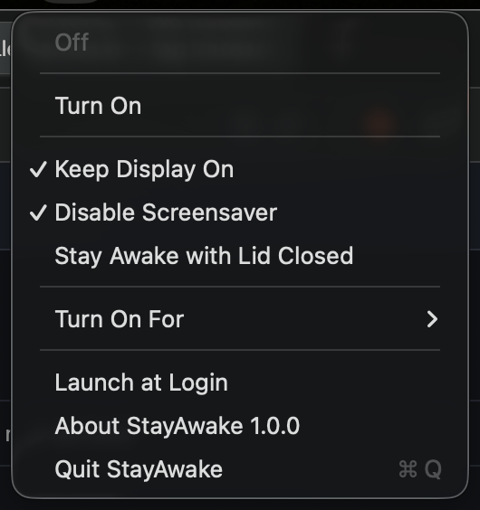
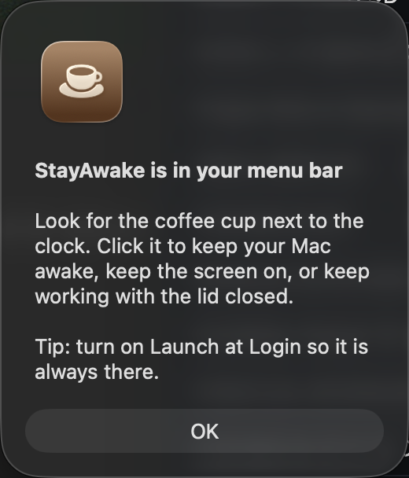

# StayAwake

A tiny macOS menu bar app that keeps your Mac awake. Screen on, no screensaver, no lock, and it can keep working with the lid closed.

Built for running long automations, downloads, renders and builds on a MacBook without babysitting it.

<p align="center">
  
  &nbsp;&nbsp;
  
</p>

## Install

Needs macOS 13 Ventura or newer and the Xcode Command Line Tools (the installer will offer to fetch them).

```bash
git clone https://github.com/alexandregillan/StayAwake.git
cd StayAwake
./install.sh
```

That's it. A coffee cup appears next to your clock. Click it.

## What it does

| Menu item | Effect |
|---|---|
| **Turn On / Off** | Keeps the Mac from idle-sleeping |
| **Keep Display On** | Screen stays lit |
| **Disable Screensaver** | Screensaver never starts, so the Mac never locks |
| **Stay Awake with Lid Closed** | Keep working with the lid shut, no external monitor needed |
| **Turn On For** | 1h, 2h, 4h, 8h, until 9 AM, or no limit |
| **Launch at Login** | Always in the menu bar |

The cup is hollow when off and filled when on. Turning it off, or quitting, puts everything back the way it was.

## The lid-closed part

macOS will not let a normal app stop the Mac from sleeping when you shut the lid. The only way is `pmset disablesleep`, which needs administrator rights.

The first time you click **Stay Awake with Lid Closed**, StayAwake asks:

- **Set Up Once** installs a small rule so it never asks for your password again.
- **Ask Each Time** shows the normal macOS password dialog on every toggle.

The rule lives at `/etc/sudoers.d/stayawake` and allows exactly two commands, nothing else:

```
you ALL=(root) NOPASSWD: /usr/bin/pmset -a disablesleep 1
you ALL=(root) NOPASSWD: /usr/bin/pmset -a disablesleep 0
```

It is validated with `visudo` before being written and can be removed at any time with `sudo rm /etc/sudoers.d/stayawake`. Read [`scripts/install-sudoers.sh`](scripts/install-sudoers.sh) yourself, it is short.

**Good to know:** with the lid shut and no external display, the Mac keeps running inside a closed case. Fine on power, warmer on battery.

## Uninstall

```bash
./uninstall.sh
```

Quits the app, restores sleep and screensaver settings, removes the sudoers rule and deletes the app.

## Safety net

If StayAwake is ever force-killed while lid mode is on, run `sudo pmset -a disablesleep 0` to restore normal sleep. The app also detects this on its next launch and cleans up.

## Bonus: Touch ID for sudo

Unrelated to the app, but handy if you would rather use your fingerprint than type a password in the terminal:

```bash
sudo scripts/enable-touchid-sudo.sh
```

Uses Apple's own `sudo_local` mechanism, survives macOS updates, undo with `sudo rm /etc/pam.d/sudo_local`.

## How it's built

One Swift file, no dependencies, no Xcode project. `scripts/build.sh` compiles it with `swiftc` and ad-hoc signs it. Because you build it on your own machine, Gatekeeper does not quarantine it and no paid Developer ID is needed.

- Sleep prevention uses `IOPMAssertionCreateWithName` (the same thing `caffeinate` does)
- Screensaver control writes `com.apple.screensaver idleTime`
- Lid mode reads the kernel's `SleepDisabled` flag from `ioreg` and sets it via `pmset`

## License

MIT
